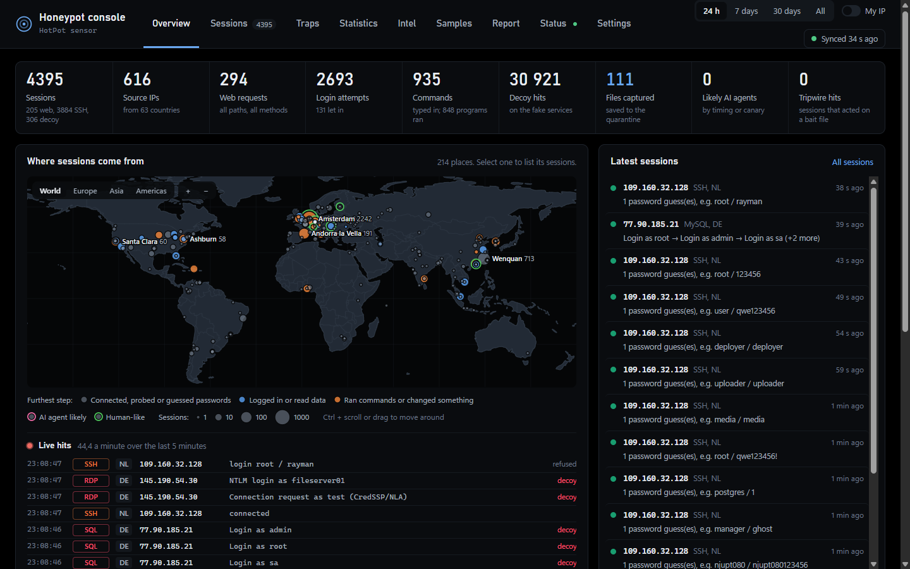
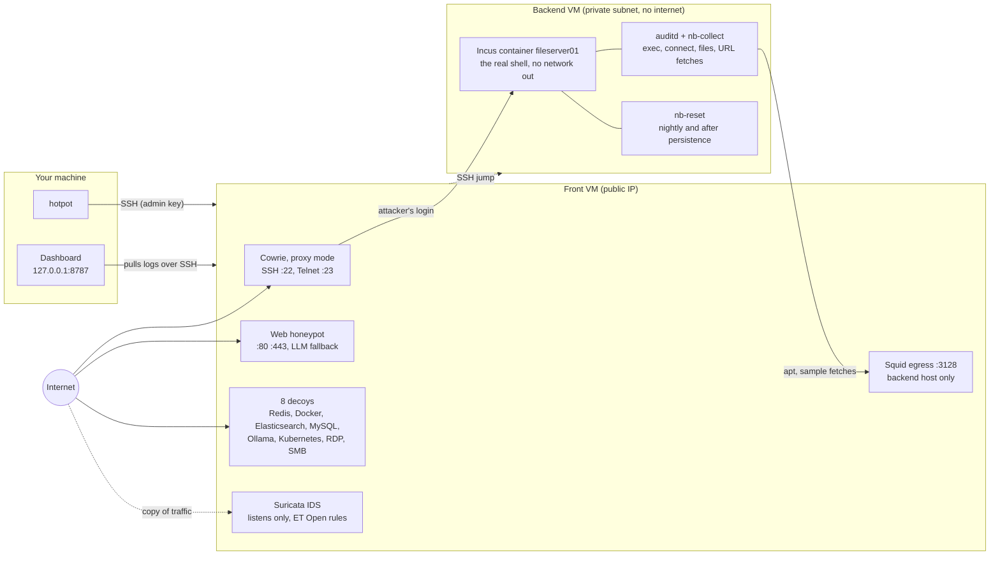
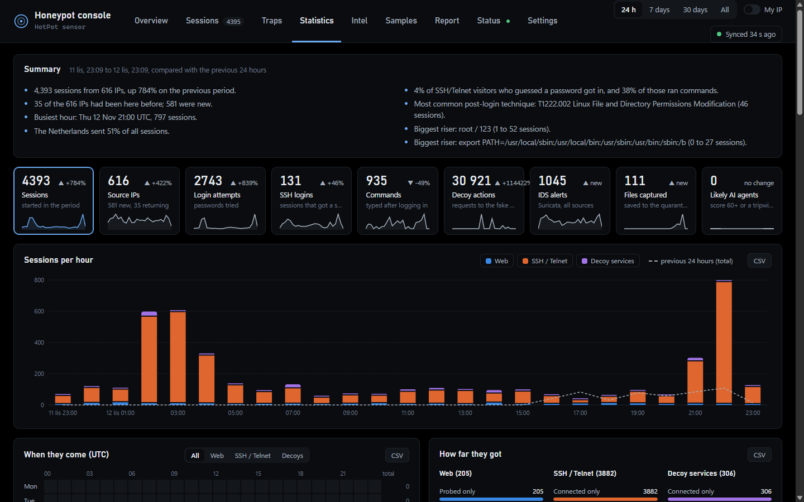
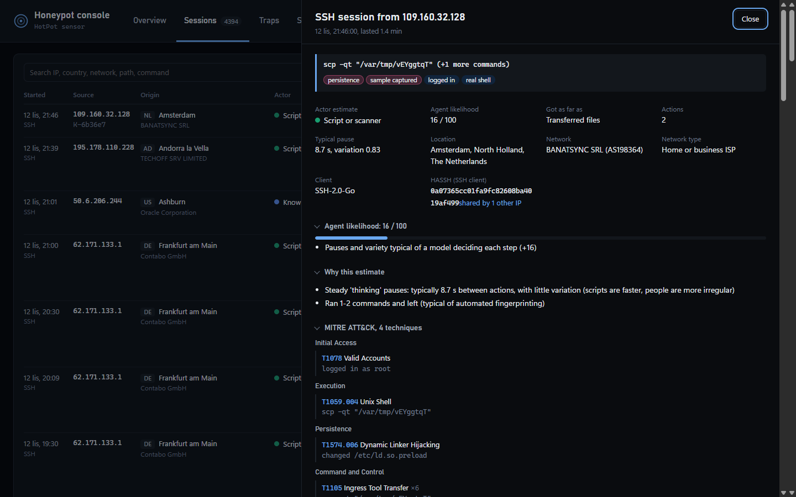

# HotPot

[](https://github.com/kvviingu/HotPot/actions/workflows/ci.yml)
[](https://github.com/kvviingu/HotPot/releases/latest)
[](LICENSE)


**A research honeypot that catches bots, human attackers and autonomous AI agents in a real shell,
and shows you what they did on a local threat-intel dashboard.**

<p align="center"></p>

HotPot is a research honeypot for watching what bots, human attackers and autonomous AI agents do after
they break into a server. Attackers find a believable, slightly neglected Ubuntu 24.04 file server
("fileserver01" at the fictional Northbridge Logistics). Behind its SSH and Telnet logins is a **real
Linux container**, not an emulated shell. Every program they start, every connection they try and every
file they drop is recorded. Samples stay in a quarantine on the servers.

## About this project

HotPot is a personal project I built to learn how internet threats work: what scanners, botnets,
human intruders and AI agents actually do once they find an exposed server. I'm not a programmer, so
most of the code was written with the help of AI (Claude). I designed the setup, ran it on my own
servers and checked how it behaves, but I didn't write most of it line by line.

The code was reviewed for security problems with Claude Opus 5.5, and the issues it found were fixed.
That is not a professional audit. HotPot deliberately invites attackers, so read the code and
[Safety and ethics](#safety-and-ethics) before you run it, and run it only on infrastructure you can
afford to lose.

**No guarantee or warranty.** HotPot is provided as is, without any warranty (see the
[licence](LICENSE)). You use it at your own risk and are responsible for what you deploy.

## Architecture



Plain-text version:

```
                 internet                                  private subnet, no internet
                     │
   ┌─────────────────┴───────────────────────┐          ┌──────────────────────────────────────┐
   │ FRONT VM                                │          │ BACKEND VM                           │
   │  :22 :23  Cowrie (proxy mode) ──────────┼─ login ─▶│  Incus container "fileserver01"      │
   │  :80 :443 web honeypot (+LLM fallback)  │          │  (real Ubuntu, nginx, PHP app, users)│
   │  8 decoys (Redis, Docker, ES, MySQL,    │          │   ↳ no network out                   │
   │    Ollama, K8s, RDP, SMB)               │          │  auditd: every exec / connect        │
   │  :3128    Squid, backend host only ◀────┼──────────┤  nb-collect (1 min): events, files,  │
   │  Suricata IDS (listens, no ports)       │          │     memory-only binaries, URL fetch  │
   │  :ADMIN   your SSH                      │          │                                      │
   └─────────────────┬───────────────────────┘          │  nb-reset: nightly + on persistence  │
                     │ SSH (admin key)                  └──────────────────────────────────────┘
          ┌──────────┴──────────┐
          │ your machine        │  hotpot     ·  dashboard on 127.0.0.1:8787 (pulls logs over SSH)
          └─────────────────────┘
```

## Features

**Capture**
* Cowrie in proxy mode: connections, HASSH fingerprints, every login attempt, typed commands, tunnel
  requests, TTY recordings for replay.
* Real shell in an Incus container: auditd logs every program and outbound connection, tied back to
  the Cowrie session.
* Quarantine of every file created or changed (disk, `/tmp`, `/dev/shm`), memory-only binaries, and
  files at URLs from attackers' download commands (fetched through Squid; the container stays offline).
* Web honeypot: bait files, fake admin logins, WordPress, agent surfaces (llms.txt, OpenAPI, a working MCP server, an A2A agent, AGENTS.md), LLM-generated pages for unknown
  paths.
* Eight decoy services with canned replies: Redis, Docker API, Elasticsearch, MySQL, Ollama, Kubernetes
  API, plus RDP and SMB that capture NTLM logins (NetNTLMv2 hashes).
* Suricata network IDS on the front VM: ET Open rule alerts and JA3/JA4 TLS client fingerprints. It
  only listens and opens no ports.

**Analysis**
* AI-agent likelihood score (0-100) per session and canary **tripwires**: each token or credential sits
  in one bait file, so a hit tells you what the visitor read.
* Known-bot signatures that classify common botnet command lines.
* MITRE ATT&CK techniques per session, mapped from its own commands, requests, file changes and IDS
  alerts, each with the evidence behind it.
* HASSH, JA4H and JA3/JA4 fingerprints; campaigns, i.e. sessions grouped by their normalised command sequence.
* Sample checks with YARA (on the VMs), VirusTotal and MalwareBazaar (hash lookups; uploads only after
  you confirm).
* IP reputation from AbuseIPDB and GreyNoise.

**Sharing**
* Indicator export from the Intel tab: attacker IPs, SHA-256 hashes of captured files, and the URLs and
  domains attackers fetched, as a STIX 2.1 bundle, a MISP event, CSV or a plain blocklist, with a TLP
  marking. Your own IPs, private addresses and the install's own names are always left out.
* Log forwarding from the dashboard to syslog (RFC 5424 over UDP, TCP or TLS), Elasticsearch or
  OpenSearch, Splunk HEC, or any HTTP endpoint that takes NDJSON. One JSON document per event; nothing
  is sent twice, and nothing is lost while the destination is down.

**Operations**
* Early container reset when an attacker writes persistence (keys, cron, systemd, sudoers and so on),
  on top of the nightly reset.
* Daily clean-up on both VMs: rotated logs and recordings after `LOG_KEEP_DAYS`, samples and harvests
  after `SAMPLE_KEEP_DAYS`, and the oldest data first whenever the disk passes `DISK_MAX_PERCENT`.
  Your dashboard keeps its own copy of every log line, so history is not lost.
* Weekly report per ISO week, saved every Monday as a self-contained HTML page.
* Local dashboard with tabs Overview, Sessions, Traps, Statistics, Intel, Samples, Report, Status and
  Settings. The Overview map zooms by region and colours each place by how far its sessions got. Statistics compares each period with the one before it (trends, heatmap, funnels,
  distributions, ATT&CK grid, rising and falling items, CSV export).

## Screenshots

| Statistics | Session detail |
|---|---|
|  |  |

## Quick start

You need one VM (or two, for the real-shell backend) running Ubuntu 22.04/24.04 or Debian 12/13,
amd64 or arm64 (Oracle Cloud Always Free works), set up as in
[docs/cloud-setup.md](docs/cloud-setup.md). On your own computer you need Python 3.10+ and the
OpenSSH client (built into Windows 10/11, macOS and most Linux systems). Nothing else to install.

Linux or macOS:

```bash
curl -fsSL https://raw.githubusercontent.com/kvviingu/HotPot/main/get.sh | sh
```

Windows (PowerShell):

```powershell
irm https://raw.githubusercontent.com/kvviingu/HotPot/main/get.ps1 | iex
```

Both download the latest release into a `hotpot` folder and start `hotpot setup`. Read the scripts
first if you like ([get.sh](get.sh), [get.ps1](get.ps1)); they install nothing system-wide. Or clone
the repo yourself:

```bash
git clone https://github.com/kvviingu/HotPot.git hotpot && cd hotpot
./hotpot setup        # Windows: .\hotpot setup  (cmd or PowerShell, in this folder)
./hotpot dashboard    # opens http://127.0.0.1:8787
```

`hotpot setup` asks seven questions: cloud provider, one or two VMs, your SSH key (it can create
one), the VMs' addresses (the private IP is looked up for you), decoys and IDS, an optional
OpenRouter key, and your own IP. It writes `honeypot.conf` and `secrets/openrouter.env`, gives the
install its own identity (`persona.json`, see [below](#every-install-looks-different)) and prints
the cloud firewall rules for your provider. Then it checks both VMs, deploys them and tests every
public port from your computer. Run it again any time to change answers; your current values are
the defaults.

The first deploy moves your admin SSH to `ADMIN_SSH_PORT`, because Cowrie takes port 22. Open that
port in the cloud firewall (from your IP only) first. If you forget, nothing breaks: the new port is
tested from your machine and the move is undone if it cannot be reached
([operations.md](docs/operations.md#installer)).

| `hotpot` command | Does |
|---|---|
| `setup` | the questions above, then `check` and `deploy` |
| `check` | validates `honeypot.conf`, SSH access, and runs the preflight checks on both VMs (changes nothing) |
| `deploy` | front VM, backend VM (if enabled), dashboard config, port test. `deploy front` or `deploy backend` does one VM. Safe to re-run. |
| `persona` | quick backend update: persona files, tripwires, collector and reset scripts, new clean snapshot |
| `identity` | shows this install's company, host name and canary prefix; `identity new` makes a fresh one |
| `update` | gets the latest release (settings, identity and data stay), then offers to redeploy |
| `version` | this copy's version |
| `ports` | tests every public port from your computer: open, closed (nothing listens) or blocked (cloud firewall) |
| `status` | container and timer health, number of quarantined samples |
| `cleanup` | disk use per kind of data on the VMs; `cleanup dry-run` lists what the daily clean-up would delete, `cleanup run` runs it now |
| `dashboard` | writes `dashboard/config.json`, starts the dashboard and opens it. `--autostart on` starts it at login. |
| `ssh front`, `ssh backend` | a shell (or one command) on either VM |

`./deploy.sh` still works and passes its old commands (`front`, `all`, `ssh-front`, ...) on to `hotpot`.

The installers also run on a VM from an unpacked copy of the repo that holds `honeypot.conf`:
`sudo bash install/front.sh`, then `sudo bash install/backend.sh` (which also needs `backend.env` from
the front VM).

### Every install looks different

The repo's persona files are written for one reference company, "Northbridge Logistics" on
`fileserver01`. Because the repo is public, those exact values would let anyone recognise a HotPot box.
So `hotpot setup` gives each install its own random identity in `persona.json` (gitignored): company
name and domain, host name, the canary prefix (`XX-AGENT-CHECK-<lure>` becomes, say,
`KF-ASSIST-VERIFY-<lure>`), the canary values and all tripwire credentials. `hotpot` swaps the reference
values for these in every file it sends to the VMs, and the dashboard reads the same file to recognise
them. `hotpot identity` shows it; [operations.md](docs/operations.md#changing-the-identity) covers
changing it later.

## Configuration

One file, `honeypot.conf` (copied from [honeypot.conf.example](honeypot.conf.example), gitignored),
describes a deployment. API keys never go there: the OpenRouter key lives in `secrets/openrouter.env`,
and the sample and reputation keys are entered in the dashboard's Settings tab. Full reference:
[docs/configuration.md](docs/configuration.md).

## Repository layout

```
honeypot.conf.example   every setting of a deployment (copy to honeypot.conf)
hotpot.py               operator tool, runs on your machine (hotpot / hotpot.cmd start it)
persona.py              per-install identity: generates it and swaps it into the files sent to the VMs
get.sh, get.ps1         one-line installers (download the latest release, start hotpot setup)
deploy.sh               old entry point, passes its commands to hotpot
install/                on-VM installers: front.sh, backend.sh, lib.sh
docker-compose.yml      front VM services: cowrie, web, decoys, ids, egress
cowrie/                 Cowrie patches (realism, login policy, proxy login) and the persona
  honeyfs/              persona files: users, histories, web app, bait files (used by both shells)
  patches/passwords.txt passwords that "work"
web/                    web honeypot (aiohttp)
decoys/                 decoy services (honeysvc.py)
ids/                    Suricata config, rule-group exclusions, daily upkeep script
egress/                 Squid config template for the backend's proxy
backend/                container setup, nb-collect, nb-reset, persona scripts, systemd units
yara/rules/             YARA rules pushed to both VMs
dashboard/              local dashboard (stdlib Python + vanilla JS, no CDN)
secrets/                example env file for the OpenRouter key
docs/                   setup, configuration, operations, design notes
tests/                  unit tests (python -m unittest discover -s tests)
.github/                CI workflow, issue and pull request templates
```

## Safety and ethics

* Run HotPot only on infrastructure you control, and check your cloud provider's terms and local law on
  honeypots and storing malware.
* Attackers can't use the box against others: the container has no network route, only the backend
  host can reach Squid, and Squid refuses private and metadata addresses. Decoys never execute or fetch
  anything they receive.
* The container is reset every night and soon after any persistence attempt.
* Samples stay root-only on the backend VM. The dashboard's download is a password-protected zip
  (`infected`) for an isolated analysis machine; never unpack it on your workstation. Hash lookups send
  only the SHA-256; uploads share the file and ask first.
* Everything collected is attacker-controlled text. The dashboard escapes it and listens on
  127.0.0.1 only.
* The canaries only tell visitors where to look; they never ask anyone to do harm.

Read [docs/operations.md](docs/operations.md) before you handle samples.

## Documentation

| Doc | What's in it |
|---|---|
| [docs/cloud-setup.md](docs/cloud-setup.md) | subnets, firewall rules, VM shapes |
| [docs/configuration.md](docs/configuration.md) | `honeypot.conf`, dashboard config and settings, secrets |
| [docs/operations.md](docs/operations.md) | where data lives, handling samples, routine, persona, login policy, troubleshooting |
| [docs/detection.md](docs/detection.md) | agent score, tripwires, known bots, campaigns, early resets, decoys, MITRE ATT&CK, Suricata |
| [docs/dashboard.md](docs/dashboard.md) | dashboard tabs, statistics, samples, YARA, reputation, replay, weekly report |
| [docs/fleet-design.md](docs/fleet-design.md) | proposal: many sensors, one master (not built) |

## Contributing and security

Issues and pull requests are welcome: start with [CONTRIBUTING.md](CONTRIBUTING.md) (setup, tests, ground
rules), and see [CHANGELOG.md](CHANGELOG.md) for what changed between releases. Please report vulnerabilities privately as described in [SECURITY.md](SECURITY.md), not in a
public issue.

## Licence

[MIT](LICENSE). Cowrie, Suricata, Squid, Incus and the other tools HotPot installs keep their own
licences.

## Third-party data

`cowrie/patches/passwords.txt` is built from public password lists (SecLists, MIT licence; Mirai
default credentials). Location data in the dashboard comes from DB-IP Lite (CC BY 4.0) and the map
outline and country borders from Natural Earth via world-atlas (public domain); all are downloaded on
first run.
